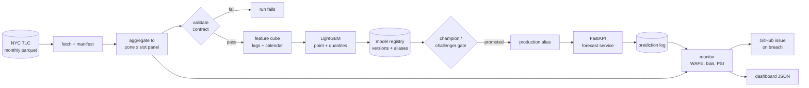

# Demand Forecasting Service

**A production demand forecasting system for NYC taxi data: scheduled retraining, a
champion/challenger promotion gate, a served forecast API, and drift monitoring that files an
issue when the model decays.**

[](https://github.com/Aprameya-C-V/demand-forecasting-platform/actions/workflows/ci.yml)
[](https://github.com/Aprameya-C-V/demand-forecasting-platform/actions/workflows/monitor.yml)


Project page: <https://aprameya-c-v.github.io/demand-forecasting-platform/> ·
Monitoring dashboard: <https://aprameya-c-v.github.io/demand-forecasting-platform/dashboard/>

## What it does

Predict trips per TLC zone per 30 minute slot for the next day, so dispatch can position supply.
The model is not the interesting part. The platform around it is:

| Stage | What happens | Where |
|---|---|---|
| Ingest | Monthly TLC parquet downloaded, SHA-256 recorded in a manifest | `forecast fetch` |
| Validate | Dense zone-slot panel contract; a missing slot fails the run | `forecast panel` |
| Train | Time split, point model plus p10/p90 quantiles, early stopping | `forecast train` |
| Gate | Challenger replaces production only if WAPE improves by 2% | `ModelRegistry.should_promote` |
| Serve | Health, readiness, model metadata, forecasts, Prometheus metrics | `forecast serve` |
| Monitor | WAPE, bias and PSI on realised demand; breach opens an issue | `forecast monitor` |

## Results

Held out window 17 to 30 September 2026 (176,736 zone-slot rows), one run per configuration.

| Metric | Value |
|---|---|
| WAPE | 0.218 |
| MAE | 2.32 trips per slot |
| RMSE | 6.92 |
| Bias | -2.5% |
| p10-p90 coverage | 0.794 (nominal 0.80) |
| Max PSI vs training reference | 0.017 |

Error varies by hour: 17.6% in the evening peak, 44.4% at 04:00 where volume is small. The
dashboard carries the hourly profile.

## Architecture



Training, monitoring and the container build run in GitHub Actions. There is no always-on
infrastructure: the service is a container that can run anywhere, and the pipelines only read and
write repository artefacts.

## Quickstart

```bash
uv venv && uv sync

uv run forecast fetch      # download the published TLC months (~300 MB, cached in data/raw)
uv run forecast panel      # aggregate + validate -> data/processed/panel.parquet
uv run forecast train      # train, register, promote if the gate passes (~2 min on an M-series Mac)
uv run forecast monitor    # replay realised demand, write reports/ and docs/dashboard/data.json
uv run forecast serve      # http://127.0.0.1:8000/docs
```

On macOS, LightGBM needs OpenMP: `brew install libomp`. The container image includes it.

## API

```bash
curl localhost:8000/healthz
curl localhost:8000/readyz
curl localhost:8000/v1/model
curl "localhost:8000/v1/zones/161/forecast?slots=48"
curl -X POST localhost:8000/v1/forecast -H 'content-type: application/json' \
     -d '{"zone_id":132,"slots":8,"quantiles":true}'
curl localhost:8000/metrics
```

| Endpoint | Purpose |
|---|---|
| `GET /healthz` | liveness, no dependencies |
| `GET /readyz` | readiness: model and feature store loaded |
| `GET /v1/model` | version, alias, metrics, feature list, data window |
| `GET/POST /v1/forecast` | zone forecast, p50 with optional p10/p90 band |
| `GET /metrics` | Prometheus counters, latency histogram, model gauge |

Forecasts are one day ahead: the feature store ends at the last published month and the API
answers for the slots after it. A `start` outside that window is a 422, an unknown zone is a 404.

## Repository layout

```
src/demand_forecast/
  config.py          typed config, YAML plus DF_* environment overrides
  data/fetch.py      download, SHA-256, manifest
  data/aggregate.py  trips -> dense zone x slot panel
  data/validate.py   panel contract
  features.py        cube reshaping, lags, rolling demand
  train.py           time split, boosters, metadata, drift reference
  evaluate.py        WAPE, MAE, RMSE, bias, coverage, pinball
  registry.py        versioned artefacts, aliases, promotion gate
  monitor.py         PSI, metrics report, threshold decision
  serve/predictor.py loads a version and serves from memory
  serve/app.py       FastAPI service with metrics and request logging
  cli.py             fetch, panel, train, monitor, serve, pipeline
configs/base.yaml    months, split, model params, gates and thresholds
docs/                project page, dashboard, runbook, model card, data card
tests/               46 tests: contracts, features, gate, API, monitoring
.github/workflows/   ci, train, monitor, container
```

## Automation

| Workflow | Trigger | Does |
|---|---|---|
| `ci.yml` | push, pull request | ruff, mypy strict, pytest, pipeline smoke test on a small month |
| `train.yml` | monthly schedule, manual | fetch, panel, train, register, promote, upload artefacts, commit dashboard data |
| `monitor.yml` | daily schedule, manual | replay recent demand, fail on a gate breach, open or update an issue |
| `container.yml` | tag, manual | build the image, smoke test the container, publish to GHCR |

## Design notes

- **A challenger is registered even when it loses.** The registry keeps the metric it lost on,
  which is how the next candidate is compared. Losing is data, not an error.
- **The gate is relative, not absolute.** WAPE must improve by 2% over the champion, which stops a
  retrain from promoting on noise.
- **Validation is part of the pipeline.** The panel contract is checked before training, because a
  missing slot silently corrupts every lag built on top of it.
- **One feature path.** Training and serving reshape the same dense panel into the same cube, so a
  lag cannot drift between the two.

Details: [`docs/RUNBOOK.md`](docs/RUNBOOK.md) for operations, rollback and incident steps,
[`docs/MODEL_CARD.md`](docs/MODEL_CARD.md) and [`docs/DATA_CARD.md`](docs/DATA_CARD.md) for the
model and the data.

## Limits

- One run per configuration. Only large differences are claimed.
- Aggregate trips only: no weather, events or road closures yet, which is the obvious next input.
- Single day horizon. Multi day forecasts would need recursive or direct multi horizon models.
- Cost of serving is not measured; the container is sized for a small CPU instance.
- The drift reference is frozen at training time, so a long lived model needs a refresh policy.
